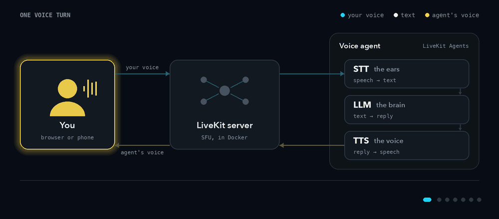
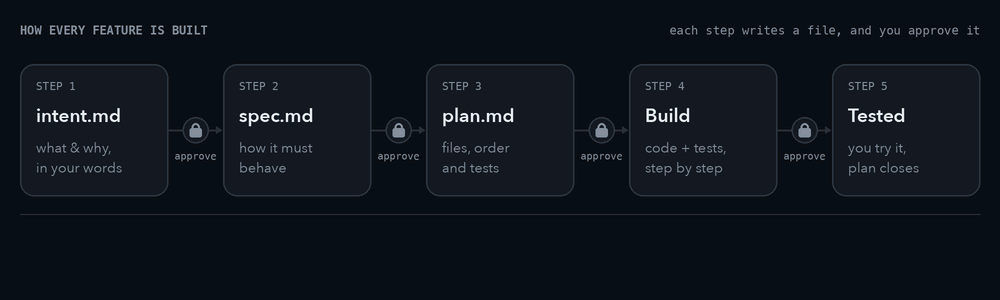

<div align="center">

<a href="https://livekit.io">
  
</a>

# LiveKit Voice Agents Mastery

**Learning to build real-time voice AI agents with [LiveKit](https://livekit.io), one project at a time.**

[](https://www.python.org/)
[](https://docs.livekit.io/agents/)
[](https://github.com/livekit/livekit)
[](https://docs.docker.com/compose/)
[](https://docs.astral.sh/uv/)
[](tests/)

[Projects](#-the-four-projects) ·
[How it works](#-how-it-works) ·
[Quick start](#-quick-start) ·
[Local LiveKit server](#-local-livekit-server) ·
[How this repo is built](#-how-this-repo-is-built) ·
[Learning notes](#-learning-notes)

<sub>A personal learning project. Not an official LiveKit project.</sub>

</div>

---

## 🎯 The four projects

Each project is a real voice agent you can talk to. They get harder as the course goes on.

| | Project | What it is | Status |
|:---:|---|---|:---:|
| 🦷 | `agents/dental_receptionist/` | A voice receptionist that books dental appointments | 🔜 Next |
| 🍽️ | `agents/restaurant/` | A multi-agent restaurant system: greeting, ordering, payment | ⏳ Planned |
| 🏥 | `agents/healthcare/` | A healthcare voice agent | ⏳ Planned |
| 📞 | `agents/contact_center/` | An AI-powered contact center | ⏳ Planned |

**Foundation, already built:** ✅ a self-hosted LiveKit server running in Docker ([spec](specs/infra/001-local-livekit-server/)).

## 🧭 How it works

A voice agent is just another **participant** in a LiveKit **room**.
You speak, the LiveKit server forwards your audio to the agent, and the agent talks back.

<p align="center">
  
</p>

New to these words? See the [glossary](GLOSSARY.md).

## 🚀 Quick start

You need: **Python 3.13**, **[uv](https://docs.astral.sh/uv/)**, **Docker**, and the **[LiveKit CLI](https://docs.livekit.io/intro/basics/cli.md)** (`lk`).

```bash
git clone https://github.com/neemydev/livekit-voice-agents-mastery.git
cd livekit-voice-agents-mastery

cp .env.example .env      # then fill in your own keys
uv sync                   # install dependencies
docker compose up -d      # start the local LiveKit server
uv run pytest             # run the tests
```

## 📡 Local LiveKit server

A self-hosted LiveKit server runs in Docker, so no LiveKit Cloud account is needed while learning.

| What | Value |
|---|---|
| URL | `ws://localhost:7880` |
| API key / secret | `devkey` / `secret` (public dev keys, for your own computer only) |
| Ports | `7880` signaling · `7882/udp` media · `7881/tcp` media backup |
| Settings | [`infra/livekit/livekit.yaml`](infra/livekit/livekit.yaml), every line explained |

```bash
docker compose up -d              # start it
docker compose ps                 # check: should say "healthy"
curl http://localhost:7880        # check: prints "OK"
docker compose logs -f livekit    # watch participants and tracks arrive
docker compose down               # stop it
```

<details>
<summary><b>🎬 Try real video through your own server</b></summary>

<br/>

```bash
# 1. A demo bot joins room "my-first-room" and streams a demo video
lk room join --url ws://localhost:7880 --api-key devkey --api-secret secret \
  --identity demo-bot --publish-demo my-first-room

# 2. In another terminal, make a token for yourself
lk token create --api-key devkey --api-secret secret \
  --join --room my-first-room --identity you --valid-for 24h
```

Then open <https://meet.livekit.io/?tab=custom>, enter `ws://localhost:7880` and your token, and join.
You should see the bot's video.

</details>

## 🛠️ How this repo is built

Every feature is planned before it is coded, following Anthropic's
[AI-native SDLC playbook](https://claude.com/resources/articles/the-ai-native-sdlc-playbook).
Each step writes a file, and each file is approved before the next step starts.

<p align="center">
  
</p>

```text
.
├── agents/              # the four voice agents (coming next)
├── docs/readme/         # README animations + the script that draws them
├── infra/livekit/       # local LiveKit server settings
├── specs/               # intent → spec → plan for every feature
├── tests/               # pytest tests
├── progress/            # learning diary and course tracker
├── GLOSSARY.md          # every key term, in 2-3 simple lines
└── docker-compose.yml   # starts everything with one command
```

## 📚 Learning notes

| | |
|---|---|
| 🎓 Main course | [LiveKit Academy](https://www.livekit-academy.com/courses) |
| 🧪 How we work | [AI-native SDLC playbook](https://academy.claude.com/courses/ai-native-sdlc-playbook) |
| 📖 Glossary | [`GLOSSARY.md`](GLOSSARY.md) |
| 📅 Learning diary | [`progress/log.md`](progress/log.md) |
| ✅ Course tracker | [`progress/course-tracker.md`](progress/course-tracker.md) |

---

<div align="center">
<sub>Built while learning, by <a href="https://github.com/neemydev">neemydev</a>.</sub>
</div>
